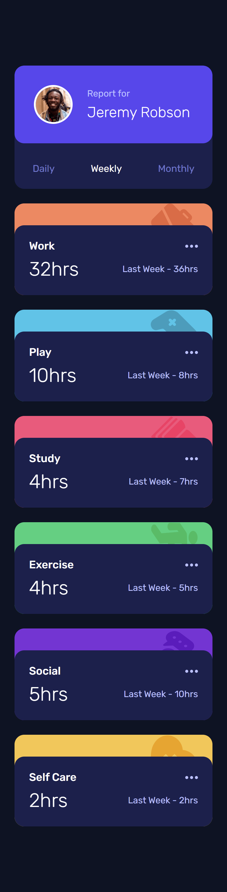

# Time Tracking Dashboard

A responsive time tracking dashboard built as a solution to the [Frontend Mentor Time Tracking Dashboard challenge](https://www.frontendmentor.io/challenges/time-tracking-dashboard-UIQ7167Jw).

The project displays activity statistics across different time periods, allowing users to switch between daily, weekly, and monthly views.

## Table of Contents

- [Overview](#overview)
- [Features](#features)
- [Screenshot](#screenshot)
- [Links](#links)
- [Built With](#built-with)
- [Project Structure](#project-structure)
- [What I Learned](#what-i-learned)
- [AI Collaboration](#ai-collaboration)
- [Future Improvements](#future-improvements)
- [Author](#author)

## Overview

### Features

- Responsive layout for mobile, tablet, and desktop screens.
- Dynamic activity cards generated from JSON data.
- Fetch API for retrieving activity data.
- Three available timeframes:
  - Daily
  - Weekly
  - Monthly
- Interactive timeframe selection.
- Hover and focus states for interactive elements.
- Accessible timeframe controls using ARIA attributes.
- SCSS architecture with organized partials and reusable design tokens.

## Screenshot




## Links

- **Frontend Mentor Challenge:** [View Challenge](https://www.frontendmentor.io/challenges/time-tracking-dashboard-UIQ7167Jw)
- **Solution URL:** [https://www.frontendmentor.io/solutions/time-tracking-dashboard-6NRRgI5Ytt]
- **Live Site:** [https://promahmoud219.github.io/time-tracking-dashboard/]
- **GitHub Repository:** [View Source Code](https://github.com/promahmoud219/time-tracking-dashboard)

## Built With

- Semantic HTML5
- CSS3
- Sass (SCSS)
- JavaScript (Vanilla JS)
- CSS Grid
- Flexbox
- CSS Custom Properties
- Fetch API
- JSON
- Responsive Design
- Mobile-first workflow

## Project Structure

```text
time-tracking-dashboard/
│
├── images/
├── styles/
│   ├── abstracts/
│   ├── components/
│   ├── layout/
│   ├── main.scss
│   └── main.css
│
├── .vscode/
├── data.json
├── index.html
├── main.js
└── README.md
```

## What I Learned

Working on this project helped me strengthen my understanding of frontend development, particularly:

### DOM Manipulation and Dynamic Rendering

- Creating reusable DOM elements with JavaScript.
- Building activity cards dynamically from external JSON data.
- Using `DocumentFragment` to assemble elements before inserting them into the document.

### Asynchronous JavaScript

- Retrieving JSON data using the Fetch API.
- Handling HTTP errors using `Response.ok`.
- Managing asynchronous initialization with `async/await` and error handling.

### Event Handling and State Management

- Using event delegation to handle timeframe selection.
- Understanding the relationship between application state and the DOM.
- Keeping the selected timeframe, visual button state, and displayed statistics synchronized.

### Accessibility

- Using semantic HTML elements.
- Grouping related controls with ARIA attributes.
- Using `aria-pressed` to communicate toggle button states.

### SCSS and Responsive Layouts

- Organizing styles into partials.
- Using Sass maps and variables to manage design tokens.
- Building responsive layouts with CSS Grid and Flexbox.
- Using `rem` units for typography.

## AI Collaboration

I used ChatGPT as a learning and development assistant throughout this project.

My workflow focused on understanding concepts and making implementation decisions rather than blindly copying generated solutions.

I used AI assistance for:

- Understanding JavaScript and DOM concepts.
- Debugging implementation issues.
- Reviewing code quality and discussing design decisions.
- Understanding accessibility practices.
- Improving Git commit messages and development workflow.

The implementation and coding decisions were carried out through my own work, with AI used as a supporting learning and review tool.

## Future Improvements

- Add automated tests for JavaScript functionality.
- Improve error handling and user feedback when activity data cannot be loaded.
- Continue refining accessibility and keyboard interaction.
- Review and improve code maintainability as the project evolves.

## Author

- **GitHub:** [@promahmoud219](https://github.com/promahmoud219)
- **Frontend Mentor:** [Add your Frontend Mentor profile]